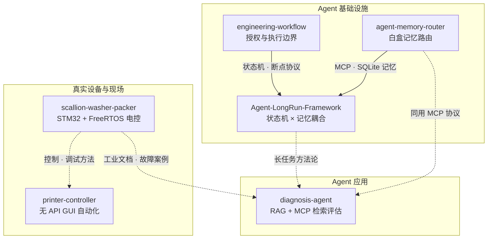

# 刘水生 · Liu Shuisheng

**嵌入式 / 运动控制背景，正在把 Agent 落到真实设备上。**

湖南交通工程学院
📮 lss486558.54@gmail.com

---

我做的事大多有一个共同点：**目标系统不给你接口，但事情必须做成。**

BambuLab 的切片软件没有 API，那就把「人在 GUI 上点鼠标」这件事本身自动化；比赛现场没有调试器，那就把重量曲线画出来，让机械振动和电噪声在图上自己现形；AI Agent 没有权限边界的概念，那就给它定义一套。

我的判断是：**Agent 工程现在最缺的不是更长的提示词，而是权限边界、自我评估权限、以及被打断后如何恢复。** 这三件事我在真实系统里都踩过坑——`engineering-workflow` 就是踩完之后写下来的。

---

> **🎯 求职意向：2027届应届生，正在寻找 AI Agent 开发 / 后端开发 / 嵌入式 FAE 岗位。随时可离校全职实习。**

---

## 项目地图

> 核心项目不是并列的六个仓库，而是三条能力线。

**快速跳转：** [项目详情](#项目) · [技术栈](#技术栈) · [获奖](#获奖) · [下一步计划](#下一步计划) · [联系](#联系)

### 三条能力线

| 能力线 | 项目 | 解决的问题 |
|---|---|---|
| **Agent 基础设施** | [agent-memory-router](https://github.com/lss486558354-ship-it/agent-memory-router) · [engineering-workflow](https://github.com/lss486558354-ship-it/engineering-workflow) · [Agent-LongRun-Framework](https://github.com/lss486558354-ship-it/Agent-LongRun-Framework) | Agent 记不住、乱写、干不长 |
| **Agent 应用** | [diagnosis-agent](https://github.com/lss486558354-ship-it/diagnosis-agent) | 工业文档检索不可评估、不可溯源 |
| **真实设备与现场** | [scallion-washer-packer](https://github.com/lss486558354-ship-it/scallion-washer-packer) · [printer-controller](https://github.com/lss486558354-ship-it/printer-controller) | 目标系统没有接口，但事情必须做成 |

### 项目关系

**怎么读这张图：**

- `agent-memory-router` 是**记忆底座**：MCP + SQLite + `raw_data/`，解决「记不住」。
- `engineering-workflow` 是**边界协议**：读写门禁 × 执行策略，解决「乱写」。
- `Agent-LongRun-Framework` 是**耦合层**：把前两者的状态机与记忆接起来，解决「干不长」。
- `diagnosis-agent` 是**应用层**：用 MCP + RAG 把工业文档变成可检索、可评估的知识库。
- `scallion-washer-packer` 和 `printer-controller` 是**现场层**：一个做嵌入式电控，一个做无 API GUI 自动化；现场文档与故障案例又反哺 `diagnosis-agent`。

> **一句话：底层能碰硬件，上层能设计 Agent 的记忆、权限与恢复机制，中间能把它们落到真实业务里。**

---

## 项目

### 🔧 [engineering-workflow](https://github.com/lss486558354-ship-it/engineering-workflow)
**给 AI 编程 Agent 的授权与推进协议** — Cursor rules + skills 模板

核心设计是把「Agent 能不能写代码」和「Agent 该写多久」拆成**两个正交维度**，而不是像大多数工作流那样混成一条状态链。这样「务必完成」模式只放宽推进节奏，不放宽授权范围——它挡掉的是一类真实事故：用户启用自主模式后，Agent 误以为「什么都能做」。

另外两条我认为最要紧的规则：

- **反幻觉完成度门禁**：CHANGELOG 的 `completed` 状态只能由用户流转。代码能编译 ≠ 功能可用，不让 Agent 自己盖章。
- **断点续接**：token 耗尽时输出结构化断点（已完成 / 下一步 / 剩余 / 关键状态），配合 `auto_resume.js` 自动触发下一轮。把「上下文窗口用完」当成一个**可恢复的正常状态**，而不是失败。

> 我也在 README 里如实写了它 6 项已知限制，包括 `auto_resume.js` 依赖 Cursor 的 DevTools DOM（很脆）、状态机是提示词级而非运行时强制。**没做的部分比做了的部分更值得说清楚。**

### 🖨️ [printer-controller](https://github.com/lss486558354-ship-it/printer-controller)
**驱动没有 API 的桌面软件的「数字员工」** — Python · 8.5k 行

拓竹 Bambu Studio 不提供 CLI、HTTP API 或插件机制，自助打印终端因此无法无人值守下发任务。本项目走第三条路：不改固件、不逆向协议，直接自动化「人在 GUI 上操作」这个行为本身。

> 📌 **受企业委托开发的商业化原型**，本仓库为其中的**早期验证版本**（含下方视频素材）；交付版含商业定制，未公开。

📹 **[现场实录演示视频](https://github.com/lss486558354-ship-it/printer-controller/releases/tag/v2.0.0)** — 未剪辑的真机运行记录（含 GIF 预览）

- **像素级状态识别**：区块截图 → RGB 欧氏距离颜色匹配，不落盘不解码完整图像，200ms 常驻轮询
- **PLC 风格状态机**：两级规则（跨状态 jump_rules + 单状态 transitions），首个命中生效；条件支持**电平触发**与**边沿触发**——没有边沿触发，状态机会在弹窗存在的每一轮轮询里重复触发同一动作
- **OTA 三层防护**：SHA256 强制校验（摘要缺失直接拒绝，不提供跳过开关）+ `member_path.resolve()` 阻断路径穿越 + 升级前自动备份
- **跨平台截图抽象**：Windows 走 GDI `BitBlt`，Linux 走 PIL，同一接口

### 🥬 [scallion-washer-packer](https://github.com/lss486558354-ship-it/scallion-washer-packer)
**叶菜切割—清洗—打包一体机电控系统** — STM32F103VE + FreeRTOS

> 🏆 **2026 中国大学生机械工程创新创意大赛 · 智能装备创新设计赛 · 本科生组 全国一等奖**
> （证书编号 `MEICC02IEIDC2026-JB1-038`｜同作品另获湖南省级竞赛主赛道叶菜组一等奖）

从传感器到执行器的完整闭环：四路串口分工（调试 / 上位机 / TJC 串口屏 / 飞特半双工总线舵机）、步进电机 + 总线舵机 + 直流电机混合驱动、1ms 软时基驱动的工艺状态机。

工程上值得一提的两个细节：

- **每个动作都挂超时兜底**。丝杆行程靠限位开关判定，但额外挂 6s 超时——限位开关失效时流程不会永久卡死。这是现场调试踩出来的。
- **串口互斥锁用 5ms 超时而非 `portMAX_DELAY`**。早期用无限等待，某任务异常持锁后整条通信链路永久阻塞。

配套写了三套上位机调试工具，其中 `serial_plotter` 把 HX711 重量曲线实时画出来——称重跳变靠肉眼看数字很难定位，画成曲线一眼就能分辨是机械振动还是电噪声。

### 🍜 餐饮电子菜单（线上运行）
**`78456.tech`** — 为家人经营的餐饮店部署的点餐系统

基于开源项目 [yshop-drink](https://github.com/guchengwuyue/yshop-drink)（MIT 许可）二次开发，部署在门店本地虚拟机中，通过**内网穿透**对外提供访问，解决门店无固定公网 IP 的问题。

> 说明：这是**二次开发 + 部署运维**，不是自研系统。业务代码归属原项目作者，我做的是本地化改造、门店菜单数据配置与内网穿透部署。

---

## 技术栈

| 领域 | 使用经验 |
|------|---------|
| **嵌入式 / 实时控制** | STM32F103（标准外设库）、FreeRTOS、Keil MDK、步进电机加减速、舵机总线协议（飞特 SCS / SM40BL）、限位与传感器闭环、UART 协议设计 |
| **上位机 / 自动化** | Python（pynput / PIL / pyserial / tkinter / PySide6）、Win32 GDI 截图、跨平台输入注入（xdotool）、Linux systemd 服务化 |
| **AI Agent 工程** | Cursor rules + skills 设计、Agent 权限模型与状态机、上下文断点恢复、Claude Code / Codex 日常使用 |
| **部署运维** | Ubuntu 22.04、香橙派 / Jetson Orin / 树莓派、systemd、内网穿透、SHA256 校验与 OTA 升级链路 |

---

## 获奖

| 时间 | 奖项 | 颁发单位 |
|------|------|---------|
| 2026.09 | 中国大学生机械工程创新创意大赛 · 智能装备创新设计赛 · 本科生组 **全国一等奖** | 中国机械工程学会 |
| 2026 | 湖南省大学生机械工程创新创意大赛 · 主赛道叶菜组 **一等奖** | 湖南省教育厅 |

参赛作品：**叶菜洁净净化处理包装一体化机械**（团队：易楚琦、杨锦成、刘水生｜指导教师：陈星光、杨启正、王琳）

---

## 下一步计划

**将白盒记忆路由扩展至超大规模业务落地，并继续深化 RAG 检索与 MCP 协议在企业级场景的应用。**

---

## 联系

📮 **lss486558.54@gmail.com**
